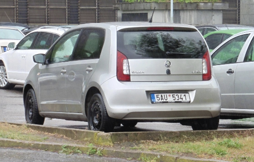
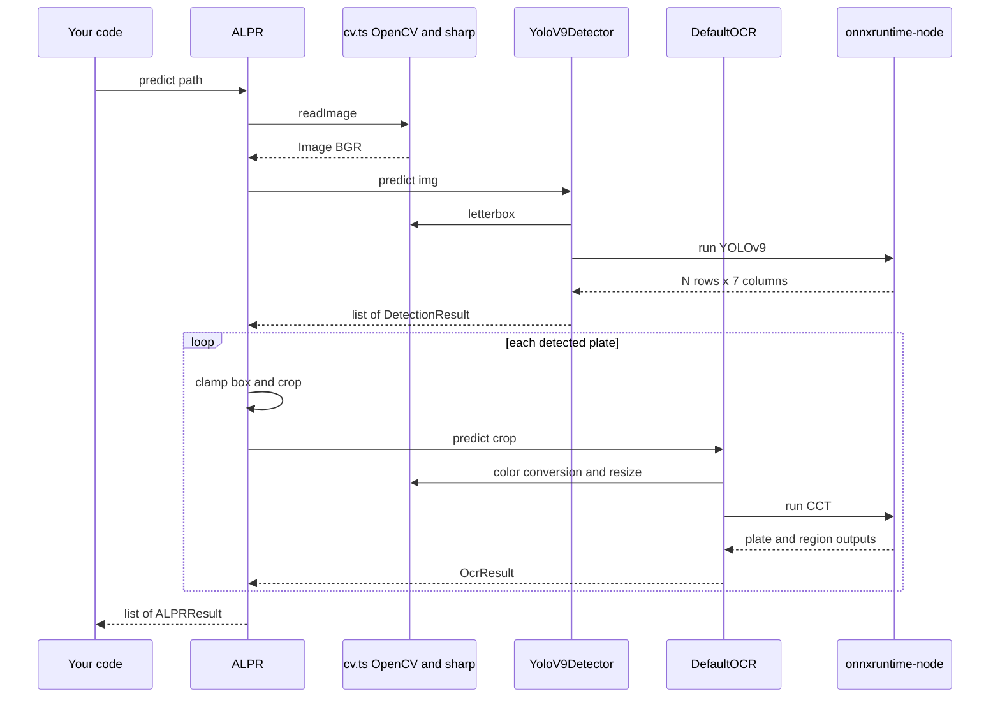
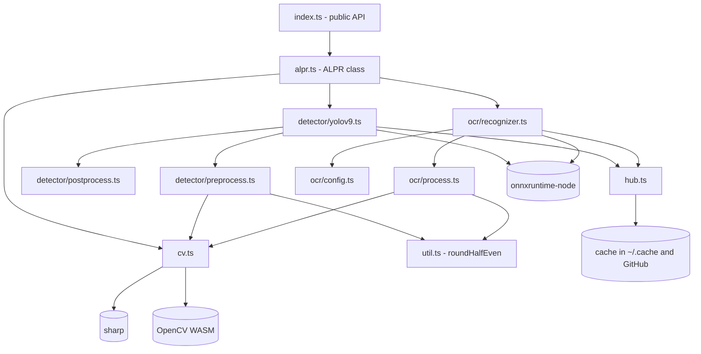

# How it works

**Language:** [English](how-it-works.en.md) · [Português](how-it-works.pt.md) · [Español](how-it-works.es.md)

This document describes the internal pipeline of `fast-alpr-node`: how an image becomes
plate detection, text, and region. The numbers and result below come from the sample
image [`assets/test_image.png`](../assets/test_image.png) (518×331 px), the same one used
in the Python comparison tests.

## Overview

The library does not reimplement the neural networks. It loads the same ONNX models as
Python `fast-alpr` and only reproduces the pre- and post-processing. Every call to
`ALPR.predict` goes through two stages in sequence: **detector** and **OCR**.



Observed result on this image:

| Field | Value |
|---|---|
| Box `(x1, y1, x2, y2)` | `(307, 187, 387, 210)` |
| Detection confidence | ≈ 0.84 |
| Text | `5AU5341` |
| Region | `Czech Republic` |

> The region is the OCR model prediction (`cct-xs-v2-global-model`). The Node port and
> the Python library return the same value on this image.

## Inputs accepted by `predict`

| Input | Example |
|---|---|
| File path | `"foto.png"` |
| Encoded bytes | `Buffer`, `Uint8Array`, `ArrayBuffer` (JPEG/PNG/WebP/…) |
| Base64 | plain string or `data:image/png;base64,...` |
| Byte stream | `fs.createReadStream(...)` or any `AsyncIterable` |
| Already-decoded `Image` | `{ data, width, height, channels }` in BGR |

Everything goes through `resolveImage` in [`src/cv.ts`](../src/cv.ts), which uses `sharp`
to decode and converts RGB → BGR.

## 1. Full call flow

```mermaid
flowchart LR
    subgraph entrada [Input]
        img["path, bytes, base64 or stream"] --> read["resolveImage: sharp decodes, BGR"]
    end

    subgraph det ["Stage 1 - detector"]
        read --> lb["letterbox 384x384"]
        lb --> t1["tensor float32 1x3x384x384, RGB, 0 to 1"]
        t1 --> yolo[("YOLOv9 ONNX")]
        yolo --> dec["decode: threshold 0.4 and undo letterbox"]
    end

    subgraph ocr ["Stage 2 - OCR"]
        dec --> crop["plate crop 80x23"]
        crop --> color["BGR to RGB"]
        color --> rs["resize 128x64"]
        rs --> t2["tensor uint8 1x64x128x3"]
        t2 --> cct[("CCT ONNX")]
        cct --> post["argmax per slot and strip pad"]
    end

    post --> out["ALPRResult: box, text, confidences, region"]
```



Step by step:

1. The image is read as **BGR** (OpenCV convention), via `sharp`.
2. The detector applies **letterbox** to 384×384, builds the tensor, and runs YOLOv9.
3. Boxes are mapped back to the original image space (default threshold `0.4`).
4. Each plate is cropped, converted to the OCR color mode, and resized.
5. OCR returns text, per-character confidence and, on v2 models, the region.

## 2. Detector letterbox

The detector requires a **square** 384×384 input. The image keeps its aspect ratio and the
remaining space is filled with gray `(114, 114, 114)`:

```text
 original 518x331                    384x384 sent to YOLO
┌────────────────────┐              ┌────────────────────┐
│                    │              │▒▒▒▒ 69 px gray  ▒▒▒│
│                    │   × 0.7413   ├────────────────────┤
│       image        │  ────────►   │   384 x 245        │
│                    │              ├────────────────────┤
│                    │              │▒▒▒▒ 70 px gray  ▒▒▒│
└────────────────────┘              └────────────────────┘
```

Numbers for this image:

- `r = min(384/331, 384/518) = 0.7413`
- height after resize: `round(331 × r) = 245`
- leftover `384 − 245 = 139` px → `dh = 69.5`
- padding: `round(dh − 0.1) = 69` on top and `round(dh + 0.1) = 70` on bottom

The box returned by the model is in 384×384 space. To map back to the original image:

```text
original_coord = trunc( (model_coord − padding) / r )
```

The `round` used for padding is Python’s (half to even). In JavaScript that is
`roundHalfEven` in [`src/util.ts`](../src/util.ts), not `Math.round`.

## 3. How OCR becomes text

The OCR model predicts **10 character slots**. Each slot has a probability for every one
of the 37 alphabet symbols (`0-9`, `A-Z`, and `_`). In each slot the highest-probability
symbol is taken; finally, trailing `_` (`pad_char`) is stripped.

| Slot | 1 | 2 | 3 | 4 | 5 | 6 | 7 | 8 | 9 | 10 |
|---|---|---|---|---|---|---|---|---|---|---|
| Symbol (argmax) | 5 | A | U | 5 | 3 | 4 | 1 | _ | _ | _ |
| Confidence | 0.9996 | 0.9997 | 0.9999 | 0.9995 | 0.9998 | 0.9996 | 0.9998 | 1.0000 | 1.0000 | 1.0000 |

After stripping the pad, the text is **`5AU5341`**.

Important notes:

- The confidence list is **not** trimmed with the text: it still has 10 values.
- In this model the YAML asks for `image_color_mode: rgb` (not gray). The BGR crop is
  converted to RGB before resize.
- Pixel normalization lives **inside** the ONNX graph: the input tensor is
  `uint8` NHWC (`1 × 64 × 128 × 3`).
- If the model exports a `region` output and the config lists `plate_regions`, OCR also
  returns the region and its confidence.

## 4. Who talks to whom



YOLOv9 end2end output has 7 columns per row:

```text
[ batch_index, x1, y1, x2, y2, class_id, score ]
```

NMS is already inside the ONNX graph. Post-processing only applies the confidence
threshold and undoes the letterbox.

## 5. File layout



### What each piece decides

| Piece | Responsibility | Where results may diverge from Python |
|---|---|---|
| [`src/cv.ts`](../src/cv.ts) | Only layer that knows OpenCV and `sharp` | OpenCV 4.10 WASM resize vs. Python 5.x (up to 1 gray level) |
| [`src/detector/preprocess.ts`](../src/detector/preprocess.ts) | Letterbox, RGB order, 0–1 scale | Python `round` (half to even) vs. `Math.round` |
| [`src/detector/postprocess.ts`](../src/detector/postprocess.ts) | Threshold, undo letterbox, truncate | Python `int()` → `Math.trunc` |
| [`src/ocr/config.ts`](../src/ocr/config.ts) | Reads YAML (size, color, alphabet, regions) | Model config drives everything |
| [`src/ocr/process.ts`](../src/ocr/process.ts) | Resize, argmax per slot, pad removal | Confidence on ambiguous characters |
| [`src/hub.ts`](../src/hub.ts) | Downloads models and stores them in cache | None: only locates files |

Detector and OCR only exchange a box `(x1, y1, x2, y2)` and an image crop. That is why
either one can be replaced with a custom implementation via the `BaseDetector` and
`BaseOCR` interfaces.

## 6. Model lifecycle

On the first run (or when the cache is empty), [`hub.ts`](../src/hub.ts) downloads the
files from GitHub and writes them to:

- `~/.cache/open-image-models/<detector-name>/`
- `~/.cache/fast-plate-ocr/<ocr-name>/`

These paths match the Python libraries, so weights already downloaded by Python
`fast-alpr` are reused. Later runs only read the cache.

You can also point to local files:

```ts
const alpr = await ALPR.create({
  ocrModelPath: "/path/model.onnx",
  ocrConfigPath: "/path/plate_config.yaml",
});
```

## 7. Structured result

Each `predict` item is an `ALPRResult`:

```ts
{
  detection: {
    label: "License Plate",
    confidence: 0.84,
    boundingBox: { x1: 307, y1: 187, x2: 387, y2: 210 },
  },
  ocr: {
    text: "5AU5341",
    confidence: [/* one value per slot */],
    region: "Czech Republic",
    regionConfidence: 0.9999,
  },
}
```

If no plate is found (or the box becomes degenerate after clamping), the list comes back
empty. If detection exists but OCR fails, `ocr` is `null`.

The JSON reference used in tests lives at
[`test/golden/test_image.json`](../test/golden/test_image.json).
