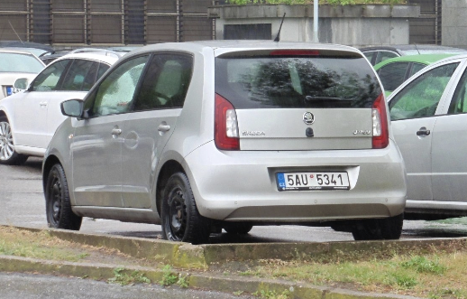
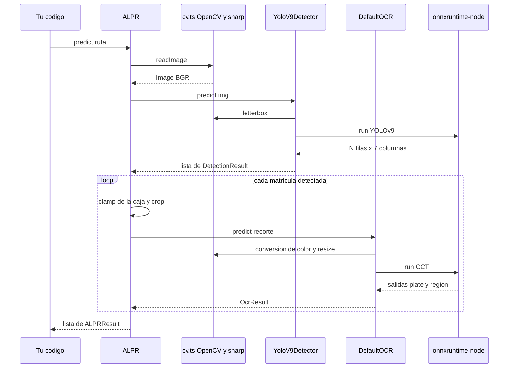
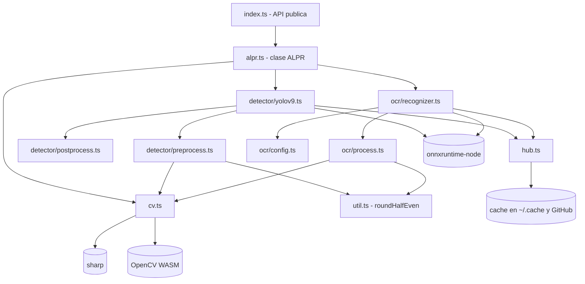

# Cómo funciona

**Idioma:** [English](how-it-works.en.md) · [Português](how-it-works.pt.md) · [Español](how-it-works.es.md)

Este documento describe el pipeline interno de `fast-alpr-node`: cómo una imagen se
convierte en detección de matrícula, texto y región. Los números y el resultado de abajo
provienen de la imagen de ejemplo [`assets/test_image.png`](../assets/test_image.png)
(518×331 px), la misma usada en las pruebas de comparación con Python.

## Visión general

La biblioteca no reimplementa las redes neuronales. Carga los mismos modelos ONNX de
`fast-alpr` Python y solo reproduce el pre y el postprocesamiento. Cada llamada a
`ALPR.predict` pasa por dos etapas en secuencia: **detector** y **OCR**.



Resultado observado en esta imagen:

| Campo | Valor |
|---|---|
| Caja `(x1, y1, x2, y2)` | `(307, 187, 387, 210)` |
| Confianza de la detección | ≈ 0,84 |
| Texto | `5AU5341` |
| Región | `Czech Republic` |

> La región es la predicción del modelo OCR (`cct-xs-v2-global-model`). El port Node y la
> biblioteca Python devuelven el mismo valor en esta imagen.

## Entradas aceptadas por `predict`

| Entrada | Ejemplo |
|---|---|
| Ruta de archivo | `"foto.png"` |
| Bytes codificados | `Buffer`, `Uint8Array`, `ArrayBuffer` (JPEG/PNG/WebP/…) |
| Base64 | cadena pura o `data:image/png;base64,...` |
| Stream de bytes | `fs.createReadStream(...)` o cualquier `AsyncIterable` |
| `Image` ya decodificada | `{ data, width, height, channels }` en BGR |

Todo pasa por `resolveImage` en [`src/cv.ts`](../src/cv.ts), que usa `sharp` para
decodificar y convierte RGB → BGR.

## 1. Flujo completo de una llamada

```mermaid
flowchart LR
    subgraph entrada [Entrada]
        img["path, bytes, base64 o stream"] --> read["resolveImage: sharp decodifica, BGR"]
    end

    subgraph det ["Etapa 1 - detector"]
        read --> lb["letterbox 384x384"]
        lb --> t1["tensor float32 1x3x384x384, RGB, 0 a 1"]
        t1 --> yolo[("YOLOv9 ONNX")]
        yolo --> dec["decode: umbral 0.4 y deshace el letterbox"]
    end

    subgraph ocr ["Etapa 2 - OCR"]
        dec --> crop["recorte de la matrícula 80x23"]
        crop --> color["BGR a RGB"]
        color --> rs["resize 128x64"]
        rs --> t2["tensor uint8 1x64x128x3"]
        t2 --> cct[("CCT ONNX")]
        cct --> post["argmax por slot y quita el pad"]
    end

    post --> out["ALPRResult: caja, texto, confianzas, región"]
```



Paso a paso:

1. La imagen se lee como **BGR** (convención de OpenCV), vía `sharp`.
2. El detector aplica **letterbox** a 384×384, monta el tensor y ejecuta YOLOv9.
3. Las cajas vuelven al espacio de la imagen original (umbral por defecto `0.4`).
4. Cada matrícula se recorta, se convierte al modo de color del OCR y se redimensiona.
5. El OCR devuelve texto, confianza por carácter y, en los modelos v2, la región.

## 2. Letterbox del detector

El detector exige una entrada **cuadrada** de 384×384. La imagen mantiene la proporción y
el espacio restante se rellena con gris `(114, 114, 114)`:

```text
 original 518x331                    384x384 enviado al YOLO
┌────────────────────┐              ┌────────────────────┐
│                    │              │▒▒▒▒ 69 px gris  ▒▒▒│
│                    │   × 0.7413   ├────────────────────┤
│       imagen       │  ────────►   │   384 x 245        │
│                    │              ├────────────────────┤
│                    │              │▒▒▒▒ 70 px gris  ▒▒▒│
└────────────────────┘              └────────────────────┘
```

Cálculos para esta imagen:

- `r = min(384/331, 384/518) = 0,7413`
- altura tras el resize: `round(331 × r) = 245`
- sobran `384 − 245 = 139` px → `dh = 69,5`
- padding: `round(dh − 0,1) = 69` arriba y `round(dh + 0,1) = 70` abajo

La caja que devuelve el modelo está en el espacio 384×384. Para volver a la imagen original:

```text
coordenada_original = trunc( (coordenada_modelo − padding) / r )
```

El `round` usado en el padding es el de Python (mitad al par). En JavaScript eso es
`roundHalfEven` en [`src/util.ts`](../src/util.ts), no `Math.round`.

## 3. Cómo el OCR se convierte en texto

El modelo OCR predice **10 slots** de caracteres. Cada slot tiene una probabilidad para
cada uno de los 37 símbolos del alfabeto (`0-9`, `A-Z` y `_`). En cada slot se toma el
símbolo de mayor probabilidad; al final se eliminan los `_` de la derecha (`pad_char`).

| Slot | 1 | 2 | 3 | 4 | 5 | 6 | 7 | 8 | 9 | 10 |
|---|---|---|---|---|---|---|---|---|---|---|
| Símbolo (argmax) | 5 | A | U | 5 | 3 | 4 | 1 | _ | _ | _ |
| Confianza | 0,9996 | 0,9997 | 0,9999 | 0,9995 | 0,9998 | 0,9996 | 0,9998 | 1,0000 | 1,0000 | 1,0000 |

Tras quitar el pad, el texto es **`5AU5341`**.

Observaciones importantes:

- La lista de confianzas **no** se recorta junto con el texto: sigue con 10 valores.
- En este modelo el YAML pide `image_color_mode: rgb` (no gris). El recorte BGR se
  convierte a RGB antes del resize.
- La normalización de píxeles vive **dentro** del grafo ONNX: el tensor de entrada es
  `uint8` NHWC (`1 × 64 × 128 × 3`).
- Si el modelo exporta la salida `region` y la config lista `plate_regions`, el OCR también
  devuelve la región y su confianza.

## 4. Quién habla con quién



La salida end2end de YOLOv9 tiene 7 columnas por fila:

```text
[ batch_index, x1, y1, x2, y2, class_id, score ]
```

El NMS ya está dentro del grafo ONNX. El postprocesamiento solo aplica el umbral de
confianza y deshace el letterbox.

## 5. Organización de los archivos



### Qué decide cada pieza

| Pieza | Responsabilidad | Dónde el resultado puede divergir de Python |
|---|---|---|
| [`src/cv.ts`](../src/cv.ts) | Única capa que conoce OpenCV y `sharp` | Resize de OpenCV 4.10 WASM vs. 5.x de Python (hasta 1 nivel de gris) |
| [`src/detector/preprocess.ts`](../src/detector/preprocess.ts) | Letterbox, orden RGB, escala 0–1 | `round` de Python (mitad al par) vs. `Math.round` |
| [`src/detector/postprocess.ts`](../src/detector/postprocess.ts) | Umbral, deshacer letterbox, truncar | `int()` de Python → `Math.trunc` |
| [`src/ocr/config.ts`](../src/ocr/config.ts) | Lee el YAML (tamaño, color, alfabeto, regiones) | La config del modelo manda en todo |
| [`src/ocr/process.ts`](../src/ocr/process.ts) | Resize, argmax por slot, eliminación del pad | Confianza en caracteres ambiguos |
| [`src/hub.ts`](../src/hub.ts) | Descarga los modelos y los guarda en caché | Ninguna: solo localiza los archivos |

El detector y el OCR solo intercambian información mediante una caja `(x1, y1, x2, y2)` y
un recorte de imagen. Por eso se puede sustituir cualquiera de los dos por una
implementación propia, vía las interfaces `BaseDetector` y `BaseOCR`.

## 6. Ciclo de vida de los modelos

En la primera ejecución (o cuando la caché está vacía), [`hub.ts`](../src/hub.ts)
descarga los archivos de GitHub y los escribe en:

- `~/.cache/open-image-models/<nombre-del-detector>/`
- `~/.cache/fast-plate-ocr/<nombre-del-ocr>/`

Estas rutas son las mismas que usan las bibliotecas Python, así que los pesos ya
descargados por `fast-alpr` Python se reutilizan. Las ejecuciones siguientes solo leen la
caché.

También es posible apuntar a archivos locales:

```ts
const alpr = await ALPR.create({
  ocrModelPath: "/ruta/modelo.onnx",
  ocrConfigPath: "/ruta/plate_config.yaml",
});
```

## 7. Resultado estructurado

Cada ítem de `predict` es un `ALPRResult`:

```ts
{
  detection: {
    label: "License Plate",
    confidence: 0.84,
    boundingBox: { x1: 307, y1: 187, x2: 387, y2: 210 },
  },
  ocr: {
    text: "5AU5341",
    confidence: [/* un valor por slot */],
    region: "Czech Republic",
    regionConfidence: 0.9999,
  },
}
```

Si no se encuentra ninguna matrícula (o si la caja queda degenerada tras el clamp), la
lista vuelve vacía. Si la detección existe pero el OCR falla, `ocr` es `null`.

La referencia JSON usada en las pruebas está en
[`test/golden/test_image.json`](../test/golden/test_image.json).
