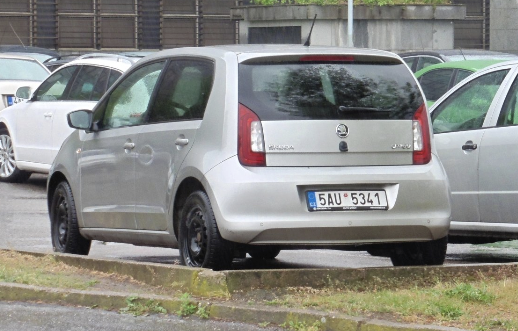
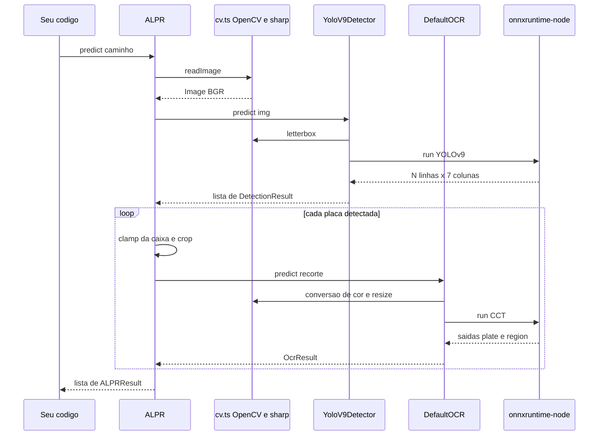
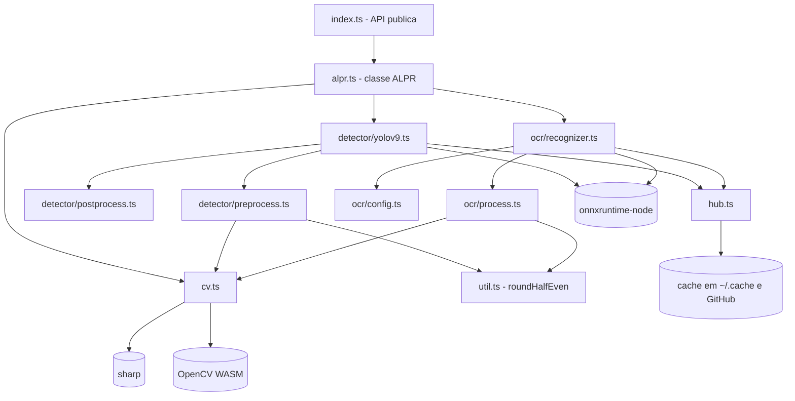

# Como funciona

**Idioma:** [English](how-it-works.en.md) · [Português](how-it-works.pt.md) · [Español](how-it-works.es.md)

Este documento descreve o pipeline interno do `fast-alpr-node`: como uma imagem vira
detecção de placa, texto e região. Os números e o resultado abaixo vêm da imagem de
exemplo [`assets/test_image.png`](../assets/test_image.png) (518×331 px), a mesma usada
nos testes de comparação com o Python.

## Visão geral

A biblioteca não reimplementa as redes neurais. Ela carrega os mesmos modelos ONNX do
`fast-alpr` Python e só reproduz o pré e o pós-processamento. Cada chamada a
`ALPR.predict` passa por duas etapas em sequência: **detector** e **OCR**.



Resultado observado nessa imagem:

| Campo | Valor |
|---|---|
| Caixa `(x1, y1, x2, y2)` | `(307, 187, 387, 210)` |
| Confiança da detecção | ≈ 0,84 |
| Texto | `5AU5341` |
| Região | `Czech Republic` |

> A região é a previsão do modelo OCR (`cct-xs-v2-global-model`). O porte Node e a
> biblioteca Python devolvem o mesmo valor nessa imagem.

## Entradas aceitas por `predict`

| Entrada | Exemplo |
|---|---|
| Caminho de arquivo | `"foto.png"` |
| Bytes codificados | `Buffer`, `Uint8Array`, `ArrayBuffer` (JPEG/PNG/WebP/…) |
| Base64 | string pura ou `data:image/png;base64,...` |
| Stream de bytes | `fs.createReadStream(...)` ou qualquer `AsyncIterable` |
| `Image` já decodificada | `{ data, width, height, channels }` em BGR |

Tudo passa por `resolveImage` em [`src/cv.ts`](../src/cv.ts), que usa o `sharp` para
decodificar e converte RGB → BGR.

## 1. Fluxo completo de uma chamada

```mermaid
flowchart LR
    subgraph entrada [Entrada]
        img["path, bytes, base64 ou stream"] --> read["resolveImage: sharp decodifica, BGR"]
    end

    subgraph det ["Etapa 1 - detector"]
        read --> lb["letterbox 384x384"]
        lb --> t1["tensor float32 1x3x384x384, RGB, 0 a 1"]
        t1 --> yolo[("YOLOv9 ONNX")]
        yolo --> dec["decode: limiar 0.4 e desfaz o letterbox"]
    end

    subgraph ocr ["Etapa 2 - OCR"]
        dec --> crop["recorte da placa 80x23"]
        crop --> color["BGR para RGB"]
        color --> rs["resize 128x64"]
        rs --> t2["tensor uint8 1x64x128x3"]
        t2 --> cct[("CCT ONNX")]
        cct --> post["argmax por slot e remove o pad"]
    end

    post --> out["ALPRResult: caixa, texto, confianças, região"]
```



Passo a passo:

1. A imagem é lida como **BGR** (convenção do OpenCV), via `sharp`.
2. O detector aplica **letterbox** para 384×384, monta o tensor e roda o YOLOv9.
3. As caixas voltam ao espaço da imagem original (limiar padrão `0.4`).
4. Cada placa é recortada, convertida para o modo de cor do OCR e redimensionada.
5. O OCR devolve texto, confiança por caractere e, nos modelos v2, a região.

## 2. Letterbox do detector

O detector exige entrada **quadrada** de 384×384. A imagem mantém a proporção e o
espaço restante é preenchido com cinza `(114, 114, 114)`:

```text
 original 518x331                    384x384 enviado ao YOLO
┌────────────────────┐              ┌────────────────────┐
│                    │              │▒▒▒▒ 69 px cinza ▒▒▒│
│                    │   × 0.7413   ├────────────────────┤
│       imagem       │  ────────►   │   384 x 245        │
│                    │              ├────────────────────┤
│                    │              │▒▒▒▒ 70 px cinza ▒▒▒│
└────────────────────┘              └────────────────────┘
```

Contas para essa imagem:

- `r = min(384/331, 384/518) = 0,7413`
- altura após o resize: `round(331 × r) = 245`
- sobram `384 − 245 = 139` px → `dh = 69,5`
- padding: `round(dh − 0,1) = 69` em cima e `round(dh + 0,1) = 70` embaixo

A caixa que o modelo devolve está no espaço 384×384. Para voltar à imagem original:

```text
coordenada_original = trunc( (coordenada_modelo − padding) / r )
```

O `round` usado no padding é o do Python (metade para o par). Em JavaScript isso é
`roundHalfEven` em [`src/util.ts`](../src/util.ts), não o `Math.round`.

## 3. Como o OCR vira texto

O modelo OCR prevê **10 slots** de caracteres. Cada slot tem uma probabilidade para
cada um dos 37 símbolos do alfabeto (`0-9`, `A-Z` e `_`). Em cada slot toma-se o
símbolo de maior probabilidade; no fim, remove-se o `_` da direita (`pad_char`).

| Slot | 1 | 2 | 3 | 4 | 5 | 6 | 7 | 8 | 9 | 10 |
|---|---|---|---|---|---|---|---|---|---|---|
| Símbolo (argmax) | 5 | A | U | 5 | 3 | 4 | 1 | _ | _ | _ |
| Confiança | 0,9996 | 0,9997 | 0,9999 | 0,9995 | 0,9998 | 0,9996 | 0,9998 | 1,0000 | 1,0000 | 1,0000 |

Depois de remover o pad, o texto é **`5AU5341`**.

Observações importantes:

- A lista de confianças **não** é aparada junto com o texto: continua com 10 valores.
- Neste modelo o YAML pede `image_color_mode: rgb` (não cinza). O recorte BGR é
  convertido para RGB antes do resize.
- A normalização dos pixels fica **dentro** do grafo ONNX: o tensor de entrada é
  `uint8` NHWC (`1 × 64 × 128 × 3`).
- Se o modelo exporta a saída `region` e a config lista `plate_regions`, o OCR também
  devolve região e a confiança dela.

## 4. Quem fala com quem



A saída end2end do YOLOv9 tem 7 colunas por linha:

```text
[ batch_index, x1, y1, x2, y2, class_id, score ]
```

O NMS já está dentro do grafo ONNX. O pós-processamento só aplica o limiar de
confiança e desfaz o letterbox.

## 5. Organização dos arquivos



### O que cada peça decide

| Peça | Responsabilidade | Onde o resultado pode divergir do Python |
|---|---|---|
| [`src/cv.ts`](../src/cv.ts) | Única camada que conhece OpenCV e `sharp` | Resize do OpenCV 4.10 WASM vs. 5.x do Python (até 1 nível de cinza) |
| [`src/detector/preprocess.ts`](../src/detector/preprocess.ts) | Letterbox, ordem RGB, escala 0–1 | `round` do Python (metade para o par) vs. `Math.round` |
| [`src/detector/postprocess.ts`](../src/detector/postprocess.ts) | Limiar, desfazer letterbox, truncar | `int()` do Python → `Math.trunc` |
| [`src/ocr/config.ts`](../src/ocr/config.ts) | Lê o YAML (tamanho, cor, alfabeto, regiões) | A config do modelo manda em tudo |
| [`src/ocr/process.ts`](../src/ocr/process.ts) | Resize, argmax por slot, remoção do pad | Confiança em caracteres ambíguos |
| [`src/hub.ts`](../src/hub.ts) | Baixa os modelos e guarda no cache | Nenhuma: só localiza os arquivos |

O detector e o OCR só trocam informação por uma caixa `(x1, y1, x2, y2)` e um recorte
de imagem. Por isso dá para substituir qualquer um dos dois por uma implementação
própria, via as interfaces `BaseDetector` e `BaseOCR`.

## 6. Ciclo de vida dos modelos

Na primeira execução (ou quando o cache está vazio), o [`hub.ts`](../src/hub.ts)
baixa os arquivos do GitHub e grava em:

- `~/.cache/open-image-models/<nome-do-detector>/`
- `~/.cache/fast-plate-ocr/<nome-do-ocr>/`

Esses caminhos são os mesmos das bibliotecas Python, então pesos já baixados pelo
`fast-alpr` Python são reutilizados. Execuções seguintes só leem o cache.

Também é possível apontar arquivos locais:

```ts
const alpr = await ALPR.create({
  ocrModelPath: "/caminho/modelo.onnx",
  ocrConfigPath: "/caminho/plate_config.yaml",
});
```

## 7. Resultado estruturado

Cada item de `predict` é um `ALPRResult`:

```ts
{
  detection: {
    label: "License Plate",
    confidence: 0.84,
    boundingBox: { x1: 307, y1: 187, x2: 387, y2: 210 },
  },
  ocr: {
    text: "5AU5341",
    confidence: [/* um valor por slot */],
    region: "Czech Republic",
    regionConfidence: 0.9999,
  },
}
```

Se nenhuma placa for encontrada (ou se a caixa ficar degenerada após o clamp), a
lista volta vazia. Se a detecção existir mas o OCR falhar, `ocr` é `null`.

A referência JSON usada nos testes está em
[`test/golden/test_image.json`](../test/golden/test_image.json).
